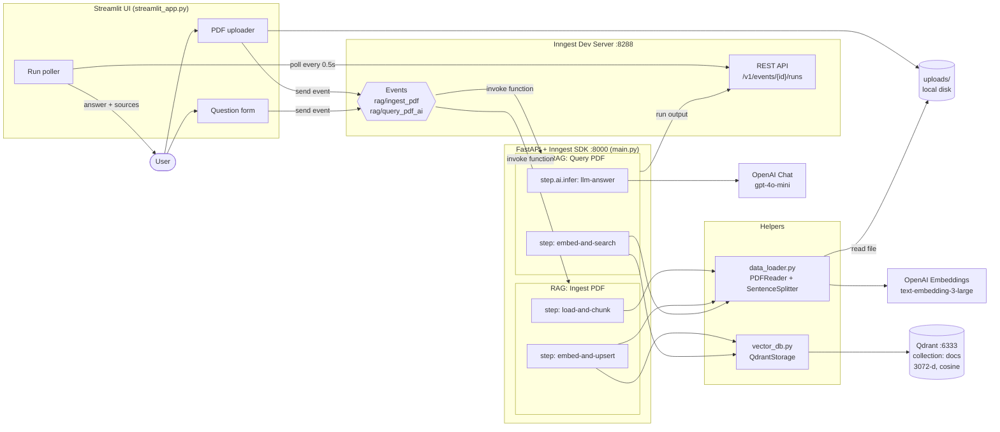
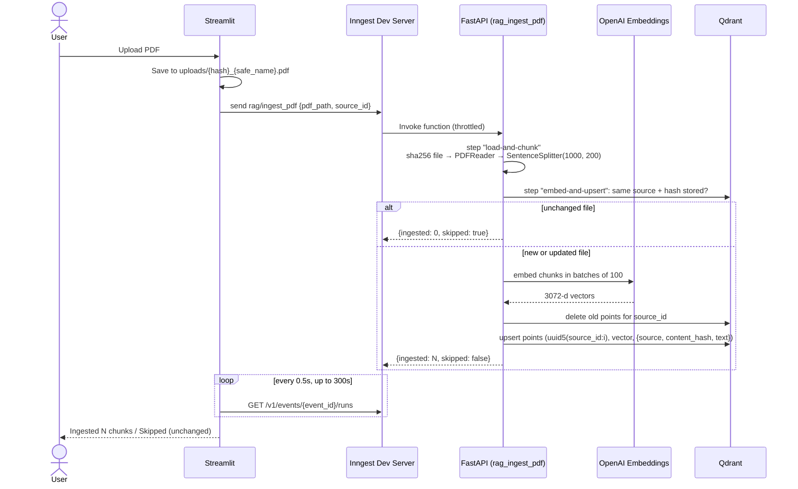
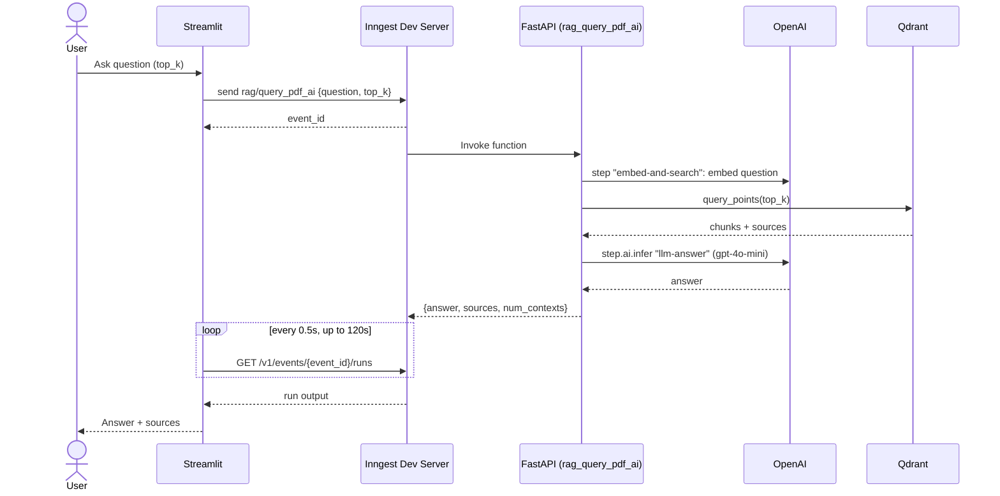

# PDF AI RAG App

Upload PDFs and ask questions about them. The app is a small Retrieval-Augmented Generation (RAG) pipeline: it splits your PDFs into chunks, embeds them with OpenAI, stores the vectors in Qdrant, and answers questions with `gpt-4o-mini` using the most relevant chunks as context.

[Inngest](https://www.inngest.com/) runs both the ingestion and the query pipelines as durable, step-based functions. That gives you retries, throttling and a local dashboard where you can watch every run.

---

## Architecture



### Ingestion flow



### Query flow



---

## Components

| File | Role |
| --- | --- |
| [main.py](main.py) | FastAPI app that serves the two Inngest functions at `/api/inngest`. |
| [data_loader.py](data_loader.py) | Loads PDFs with LlamaIndex `PDFReader`, splits them with `SentenceSplitter` (1000-token chunks, 200 overlap), and embeds text with OpenAI `text-embedding-3-large` (3072 dims) in batches of 100, with SDK retries on rate-limit and server errors. |
| [vector_db.py](vector_db.py) | `QdrantStorage` wrapper. Creates the `docs` collection on first use (3072-d, cosine), upserts points, and runs top-k search returning `contexts` and de-duplicated `sources`. |
| [custom_types.py](custom_types.py) | Pydantic models passed between Inngest steps: `RAGChunkAndSrc`, `RAGUpsertResult`, `RAGSearchResult`, `RAGQueryResult`. |
| [streamlit_app.py](streamlit_app.py) | Web UI. Saves uploads to `uploads/` under a sanitized, content-hashed name, sends Inngest events, and polls the Inngest REST API to show ingestion and query results. |
| `qdrant_storage/` | Qdrant's on-disk data, mounted into the Qdrant Docker container. |

### Inngest functions

**`RAG: Ingest PDF`**, triggered by `rag/ingest_pdf`

- Event data: `pdf_path` (absolute path, required) and `source_id` (optional, defaults to `pdf_path`).
- Steps: `load-and-chunk`, then `embed-and-upsert`.
- Throttle: at most 2 runs per minute across the app.
- `source_id` identifies a document. Uploading a file with the same name replaces that document.
- Skips unchanged files: each point stores the file's SHA-256 `content_hash`. If the same `source_id` and hash are already stored, the run returns `skipped: true` without calling OpenAI.
- On a new or changed file, all of the document's old points are deleted before the new ones are upserted, so a shorter version leaves no stale chunks.
- Point IDs are `uuid5(NAMESPACE_URL, "{source_id}:{chunk_index}")`, so a retried step overwrites points instead of duplicating them.
- Returns `{"ingested": <chunk count>, "skipped": <bool>}`.

**`RAG: Query PDF`**, triggered by `rag/query_pdf_ai`

- Event data: `question` (required) and `top_k` (optional, default 5).
- Steps: `embed-and-search`, then `llm-answer` (`step.ai.infer` with the OpenAI adapter, `gpt-4o-mini`, `temperature=0.2`, `max_tokens=1024`).
- The system prompt tells the model to answer only from the provided context.
- Returns `{"answer", "sources", "num_contexts"}`.

---

## Tech stack

- **Python 3.12**, managed with [uv](https://docs.astral.sh/uv/)
- **FastAPI** + **Uvicorn**: hosts the Inngest function endpoint
- **Inngest** (Python SDK + Dev Server): event-driven, durable workflow orchestration
- **LlamaIndex** (`llama-index-core`, `llama-index-readers-file`): PDF parsing and chunking
- **OpenAI**: `text-embedding-3-large` embeddings and `gpt-4o-mini` completions
- **Qdrant**: vector database
- **Streamlit**: frontend

---

## Getting started

### Prerequisites

- Python 3.12 and [uv](https://docs.astral.sh/uv/getting-started/installation/)
- Docker (for Qdrant)
- Node.js (to run the Inngest Dev Server with `npx`)
- An OpenAI API key

### 1. Install dependencies

```bash
uv sync
```

### 2. Configure environment

Create a `.env` file in the project root:

```env
OPENAI_API_KEY=sk-...
# Optional: override the Inngest Dev Server API used by the Streamlit poller
# INNGEST_API_BASE=http://127.0.0.1:8288/v1
```

### 3. Start the services

You need four processes. Run each one in its own terminal.

**Qdrant** (vector DB on port 6333, data persisted to `./qdrant_storage`):

```bash
docker run -d --name qdrant -p 6333:6333 -v "$(pwd)/qdrant_storage:/qdrant/storage" qdrant/qdrant
```

**FastAPI / Inngest functions** (port 8000):

```bash
uv run uvicorn main:app --reload
```

**Inngest Dev Server** (port 8288, discovers the functions at `/api/inngest`):

```bash
npx inngest-cli@latest dev -u http://127.0.0.1:8000/api/inngest --no-discovery
```

**Streamlit UI** (port 8501):

```bash
uv run streamlit run streamlit_app.py
```

### 4. Use it

1. Open http://localhost:8501.
2. Upload a PDF. Watch the ingestion run at http://localhost:8288.
3. Once ingestion finishes, type a question, choose how many chunks to retrieve, and click **Ask**.

You can also trigger functions directly from the Inngest dashboard by sending a test event, for example:

```json
{ "name": "rag/query_pdf_ai", "data": { "question": "What is this document about?", "top_k": 5 } }
```

---

## Configuration reference

| Setting | Where | Default |
| --- | --- | --- |
| Embedding model / dimension | `data_loader.py` | `text-embedding-3-large` / 3072 |
| Chunk size / overlap | `data_loader.py` | 1000 / 200 |
| Qdrant URL / collection | `vector_db.py` | `http://localhost:6333` / `docs` |
| Chat model | `main.py` | `gpt-4o-mini` |
| Ingest throttle | `main.py` | 2 runs per minute |
| Embedding batch size | `data_loader.py` | 100 inputs per request |
| Inngest API base | env `INNGEST_API_BASE` | `http://127.0.0.1:8288/v1` |
| Query poll timeout | `streamlit_app.py` | 120 s, every 0.5 s |

If you change the embedding model, update `EMBED_DIM` and the `dim` argument of `QdrantStorage` to match, then recreate the `docs` collection.

---

## Project structure

```
PDF-AI-RAG-App/
├── main.py              # FastAPI app + Inngest functions
├── data_loader.py       # PDF loading, chunking, embeddings
├── vector_db.py         # Qdrant wrapper
├── custom_types.py      # Pydantic step I/O models
├── streamlit_app.py     # Streamlit frontend
├── qdrant_storage/      # Qdrant persisted data (Docker volume)
├── uploads/             # Uploaded PDFs (created at runtime)
├── pyproject.toml       # Project metadata and dependencies
├── uv.lock
└── .env                 # API keys (do not commit)
```

---

## Known limitations

- **Local only.** The Inngest client runs with `is_production=False`, Qdrant is hard-coded to `localhost:6333`, and the Streamlit poller talks to the Dev Server API.
- **Shared filesystem.** The ingest function reads the PDF from the path Streamlit saved it to, so the UI and the API must run on the same machine.
- **Same name, same document.** Two different PDFs uploaded with the same file name replace each other in the index (their saved files don't collide, because the file name on disk includes a content hash).
- **Slow result polling.** The Inngest Dev Server caches `/v1/events/{id}/runs` responses for about 15 seconds, so the UI can take that long to show a finished run.
- **Unused pieces.** `anthropic` is a dependency and `CLAUDE_API_KEY` is in `.env`, but neither is used yet. `RAGQueryResult` is defined but not used.
